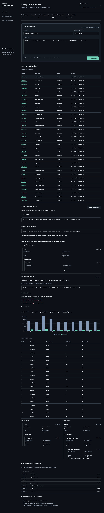
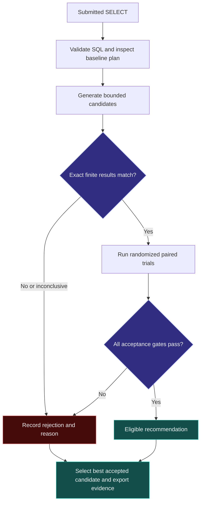

<div align="center">

# PostgreSQL Query Optimizer

**SQL rewrites and index experiments, validated against real PostgreSQL execution.**

[](pyproject.toml)
[](docker-compose.yml)
[](apps/web/package.json)
[](apps/web/tsconfig.json)
[](packages/optimizer/workflow.py)
[](LICENSE)

[Quick start](#quick-start) · [Architecture](#architecture) · [Benchmarks](#benchmarks) · [API](#api) · [Documentation](#documentation)

</div>

PostgreSQL Query Optimizer is a full-stack performance engineering workbench. It inspects execution plans, proposes SQL rewrites and indexes, checks result correctness, and runs repeated database experiments before recommending a change. A Next.js workspace exposes the SQL, plans, trial measurements, and decision behind each experiment.

PostgreSQL continues to choose execution plans. This application explores changes to the SQL and physical indexes available to that planner. Proposals come from deterministic rules, a local Ollama model, or an OpenAI-compatible endpoint; acceptance is controlled by code and measured results.

## Capabilities

| Capability | Implementation |
|---|---|
| **Plan diagnostics** | Parses `EXPLAIN (ANALYZE, BUFFERS, FORMAT JSON)` for scans, joins, row-estimate errors, sorts, and spills. |
| **SQL and index proposals** | SQLGlot expression simplification, predicate-based B-tree proposals, and local Ollama / API model proposals. |
| **Correctness checks** | Exact result comparisons across commerce, edge-case, and empty datasets; preserves types, column metadata, duplicates, NULLs, and supported ordering contracts. |
| **Measured acceptance** | Randomized paired trials, bootstrap confidence intervals, variance limits, index storage limits, and protected workload checks. |
| **Durable execution** | PostgreSQL job queue, LangGraph checkpoints, interrupted-worker recovery, cooperative cancellation, and experimental index cleanup. |
| **Inspectable results** | Hierarchical plans, baseline/candidate charts, per-trial measurements, rejection reasons, and downloadable JSON reports. |
| **Observability** | Structured stage events, Prometheus metrics, and OpenTelemetry spans. |

[Desktop workspace](docs/assets/workspace-desktop.png) · [Mobile workspace](docs/assets/workspace-mobile.png)

<details>
<summary>View the application: SQL workspace, execution plans, and benchmark evidence</summary>



</details>

## Architecture

The application database stores jobs, events, and reports. A separate benchmark database contains the disposable commerce dataset. A single worker serializes experiments so concurrent index changes cannot contaminate measurements.


| Layer | Technologies |
|---|---|
| Frontend | Next.js App Router, React, strict TypeScript, Tailwind CSS, TanStack Query, Recharts |
| API and persistence | FastAPI, Pydantic v2, SQLAlchemy, Alembic, PostgreSQL |
| Optimization engine | Python 3.12, SQLGlot, Psycopg 3, LangGraph, SQLite checkpoints |
| Runtime and telemetry | Docker Compose, Prometheus, OpenTelemetry, optional Jaeger |
| Quality checks | Pytest, Ruff, strict Mypy, ESLint, TypeScript, Playwright, GitHub Actions |

### From proposal to recommendation



Each session evaluates up to eight candidates in one proposal round. The original SQL remains the recommendation when no candidate passes. Experimental indexes are removed after measurement; recommendations are not automatically applied to an external database.

## Benchmarks

The latest [local-model evaluation](experiments/reports/ollama/evaluation.json) completed **24 sessions across 12 workloads**: one deterministic and one Ollama-assisted session per workload. Qwen2.5-Coder 3B made **12 successful inference calls**, generating **27 distinct model proposals**. Two index experiments passed every acceptance gate: one in each arm. Both accepted proposals came from deterministic rules; none of the model-generated proposals was accepted.

**Conditions:** PostgreSQL 16.16 on Linux; seed 42; 10,000 orders and 30,000 order items; warm cache; two warmup pairs and ten measured pairs per candidate. Index experiments additionally measured all 12 protected workloads with five pairs each. The Compose benchmark service is configured with two CPUs, 2 GiB memory, 256 MiB shared buffers, and 16 MiB `work_mem`.

### Accepted index experiments

| Workload | Evaluation arm | Proposal source | Baseline median | Candidate median | Median paired speedup | 95% bootstrap interval |
|---|---|---|---:|---:|---:|---:|
| Pagination | Deterministic | Deterministic | 1.0160 ms | 0.0480 ms | **21.23×** | 19.73–22.13× |
| Customer lookup | Ollama-assisted | Deterministic | 0.2345 ms | 0.0140 ms | **16.63×** | 14.93–17.70× |

Pagination used an index on `orders(status, ordered_at, id)`, reducing median execution latency by **95.3%**. Customer lookup used `orders(customer_id, ordered_at, id)`, reducing median latency by **94.0%**. Both passed exact finite-result comparisons, confidence, variance, storage, and protected workload gates. These are local microbenchmarks; absolute savings were approximately 0.968 ms and 0.221 ms per execution respectively. Paired speedups are medians of individual trial ratios, so they differ slightly from ratios of aggregate medians.

### Local LLM evaluation

| Metric | Qwen2.5-Coder 3B |
|---|---:|
| Completed workloads / inference calls | 12 / 12 |
| Model-generated candidates after deduplication | 27 |
| Model candidates passing SQL policy | 23 / 27 |
| Model candidates passing finite-result comparisons | 17 / 27 |
| Accepted model-generated candidates | **0 / 27** |
| Transport or response-schema errors | 0 |
| Median inference latency | 10.193 s |
| Total inference latency | 117.102 s |
| Reported input + output tokens | 23,837 |
| API fees | $0; local hardware and electricity excluded |

Of the 27 model proposals, four were statically rejected, five failed differential validation, and one failed database execution with an invalid table reference. The remaining 17 passed finite-result comparisons but failed subsequent acceptance gates. Successful inference therefore does not imply a correct or beneficial proposal. The Ollama arm also evaluated eight deterministic candidates; its accepted index is attributed to that source. The small model demonstrated proposal generation and evaluation, with **no accepted incremental model contribution in this run**.

[Desktop capture](experiments/reports/ollama/workspace-desktop.png) · [Mobile capture](experiments/reports/ollama/workspace-mobile.png) · [Browser check: zero recorded page exceptions](experiments/reports/ollama/browser-check.json)

The earlier [deterministic acceptance run](experiments/reports/acceptance/evaluation.json) recorded zero accepted changes. It remains available as a separate measurement; acceptance can change with observed variance and protected workload timings.

### Default acceptance policy

| Gate | Requirement |
|---|---|
| SQL policy | One permitted SELECT; allowlisted syntax, relations, and functions |
| Correctness | Exact finite comparisons pass on all three datasets |
| Latency | At least 10% median paired latency reduction, expressed as speedup ≥ `1 / 0.9` |
| Confidence | Lower bound of the 95% paired bootstrap speedup interval exceeds `1.0` |
| Stability | Baseline and candidate coefficients of variation ≤ `0.35` |
| Index storage | Experimental index size ≤ 64 MiB |
| Workload protection | For index changes, every protected workload has a lower speedup bound ≥ `0.9` |

Confidence intervals use 2,000 bootstrap resamples. p95 is omitted below 40 observations. These are small-sample, local warm-cache measurements; protected-gate failures can reflect uncertainty as well as slower execution. Index build time and correctness reads are excluded from query execution latency. Write throughput and medium/large dataset performance have not been measured. This run does not establish a model advantage over deterministic proposals.

[Raw trials, plans, and rejection reasons](experiments/reports/ollama/evaluation.json) · [Aggregate metrics](experiments/reports/ollama/summary.json) · [Methodology](docs/benchmarking.md)

## Quick start

**Requirement:** Docker with Compose. Node and Python installations are only needed for host-side development.

```sh
cp .env.example .env
docker compose up --build -d --wait
```

Compose creates both PostgreSQL databases, applies migrations, seeds the small dataset, and starts the API, worker, and frontend. Deterministic mode requires no model credentials.

| Service | Address |
|---|---|
| SQL workspace | [localhost:3000](http://localhost:3000) |
| Interactive API documentation | [localhost:8000/docs](http://localhost:8000/docs) |
| Readiness | [localhost:8000/api/v1/readiness](http://localhost:8000/api/v1/readiness) |
| Application PostgreSQL | `localhost:5433` |
| Benchmark PostgreSQL | `localhost:5434` |

Select a workload, choose the deterministic provider, and run an optimization. The completed session displays the recommendation, correctness results, plans, and benchmark evidence.

### Local LLM: Ollama, no API key

The `ollama` provider runs [Qwen2.5-Coder 3B](https://ollama.com/library/qwen2.5-coder:3b) locally (approximately 1.9 GB of model weights). It uses Ollama's [OpenAI-compatible chat endpoint](https://docs.ollama.com/api/openai-compatibility), constrains generation with the proposal JSON schema, validates the resulting proposals, and sends every candidate through the existing SQL, correctness, and performance gates. Local proposals are capped at three per call. Inference has no API fee; hardware and electricity costs are excluded.

Run the local evaluation and capture evidence:

```sh
# Screenshot capture dependencies (once)
(cd apps/web && npm ci && npx playwright install chromium)
sh scripts/evaluate_ollama.sh
```

The script reuses Ollama at `localhost:11434` or starts the optional Compose `ollama` service, downloads the model, builds the backend, validates a real model response from the worker network, and evaluates all 12 workloads with deterministic and Ollama arms. It never selects the paid API arm. Docker, network access for the initial downloads, and Node are required. The existing benchmark dataset is reused.

A shorter run uses the same gates:

```sh
sh scripts/evaluate_ollama.sh --workloads customer_lookup pagination
```

Outputs are written to `experiments/reports/ollama/`:

| Evidence | File |
|---|---|
| Raw sessions, query plans, paired trials, correctness checks | `evaluation.json` |
| Provider-separated rates, model candidates, latency, errors and tokens | `summary.json` |
| Accepted paired speedups by workload | `evaluation.md` |
| Model metadata, weight digests, runtime version and smoke call | `model-info.json`, `model-tags.json`, `ollama-version.json`, `model-smoke.json` |
| Desktop and mobile captures of a completed Ollama session | `workspace-desktop.png`, `workspace-mobile.png` |
| Screenshot session ID, model and browser errors | `browser-check.json` |

The script fails if any session is incomplete, a model call fails, or an Ollama arm only uses fallback rules. Reports are copied before these checks so failed runs remain inspectable. Smoke-check failures retain validation details in `model-smoke.json`. Screenshots require a completed real model call. An evaluated model can still produce zero useful candidates or zero accepted changes.

For interactive use, select **Ollama (local)** in the workspace. Change `PGO_OLLAMA_MODEL` to another installed model, such as `qwen2.5-coder:7b`, before running the script. A larger model requires additional memory and may exceed the bounded inference timeout.

### Alternate models and API endpoints

| Route | Configuration |
|---|---|
| Host Ollama with Docker Desktop | `PGO_OLLAMA_BASE_URL=http://host.docker.internal:11434/v1` |
| Optional Compose Ollama service | `PGO_OLLAMA_BASE_URL=http://ollama:11434/v1` |
| Python running directly on the host | `PGO_OLLAMA_BASE_URL=http://localhost:11434/v1` |
| Another OpenAI-compatible server | `PGO_OPENAI_BASE_URL`, `PGO_MODEL`, `PGO_OPENAI_API_KEY` |

For a custom OpenAI-compatible endpoint, select **OpenAI compatible**. A local server that ignores credentials can use a non-secret placeholder for `PGO_OPENAI_API_KEY`. The server must support chat completions and JSON-object output. Actual compatibility depends on the endpoint; only the shared contract is covered by automated tests. Hosted APIs require the provider's credentials and may charge fees.

```sh
# After editing .env, recreate the services to load model routing changes.
docker compose up -d --force-recreate api worker
```

`PGO_MODEL_TIMEOUT_SECONDS` bounds a model request (default 90 seconds, maximum 120). Compose reserves a conservative 32,000-token model budget. Invalid JSON, truncated responses, connection errors, and timeouts are recorded; deterministic fallback proposals retain their original source. Fallback-only sessions are excluded from model outcome rates.

### Reproduce the evaluation

With the worker running:

```sh
docker compose exec -e PGO_OPENAI_API_KEY= api \
  pg-optimizer evaluate --output /app/experiments/reports/latest
docker compose cp api:/app/experiments/reports/latest experiments/reports/latest
```

This command runs the deterministic arm and records the unconfigured OpenAI arm as `not_run`, without model calls and produces `evaluation.json`, `summary.json`, and `evaluation.md`. Add `--workloads customer_lookup pagination` to evaluate selected workloads.

The generator supports 10,000, 100,000, or 1,000,000 orders, each with three order items. To switch to the medium dataset:

```sh
docker compose stop worker
docker compose run --rm seed pg-optimizer seed --size medium --seed 42
docker compose start worker
```

Generation replaces benchmark data; existing reports retain the environment and dataset recorded at execution time.

## API

Submit a query:

```sh
curl -X POST http://localhost:8000/api/v1/optimizations \
  -H 'Content-Type: application/json' \
  -d '{"sql":"SELECT id FROM commerce.orders WHERE customer_id = 731","provider":"deterministic"}'
```

The API returns HTTP `202` with a session identifier. Substitute that identifier for `{id}` below.

| Method | Endpoint | Purpose |
|---|---|---|
| `GET` | `/api/v1/workloads` | List predefined workloads |
| `POST` | `/api/v1/optimizations` | Queue an experiment |
| `GET` | `/api/v1/optimizations/{id}` | Retrieve status and session details |
| `GET` | `/api/v1/optimizations/{id}/report` | Retrieve the JSON experiment report |
| `POST` | `/api/v1/optimizations/{id}/cancel` | Request cooperative cancellation |
| `GET` | `/metrics` | Export API Prometheus metrics |

Reports include original and recommended SQL, index proposals, diagnostics, environment metadata, candidate validation, paired measurements, acceptance policy, and model usage.

## Development and tests

Host development uses Python 3.12 in the dedicated Conda environment and Node 22. Python and npm dependencies are pinned in lockfiles.

```sh
conda env create -f environment.yml
conda activate postgres-query-optimizer
cd apps/web
npm ci
npx playwright install chromium
cd ../..
python scripts/verify_local.py
```

`verify_local.py` runs dependency consistency, Python tests, Ruff lint/format checks, strict Mypy, frontend lint/types/unit tests, the production build, and Compose configuration validation.

With Docker running and frontend browser dependencies installed, execute the stack acceptance suite:

```sh
sh scripts/verify_stack.sh
```

The stack suite builds the images, runs PostgreSQL integration and browser tests, verifies worker process recovery and cancellation, and evaluates the 12 deterministic workloads. The queue must be drained before the process recovery tests. Results are saved under `experiments/reports/acceptance`.

GitHub Actions defines separate [quality/integration](.github/workflows/ci.yml) and [manually dispatched evaluation](.github/workflows/evaluate.yml) workflows.

## Scope

The implemented workflow targets a controlled local commerce database. SQL execution uses a read-only role, repeatable-read snapshots, query timeouts, estimated-cost limits, and bounded result collection. A separate experiment role creates structured experimental indexes under an advisory lock. Compose binds exposed services to loopback.

Finite comparisons validate sampled database states rather than proving arbitrary SQL equivalence. Execution uses one worker and one proposal round. Cancellation takes effect between stages or trials, after an active statement finishes or times out. Production deployment requires deployment-specific authentication, TLS, secret management, and isolation; the included passwords are local development defaults.

## Repository map

| Path | Responsibility |
|---|---|
| [`packages/optimizer`](packages/optimizer) | SQL policy, plan analysis, providers, correctness, statistics, workflow, API, and worker |
| [`apps/web`](apps/web) | SQL workspace, plan viewer, benchmark charts, API proxy, and browser tests |
| [`datasets`](datasets) | Commerce schema and edge-case fixtures |
| [`infrastructure`](infrastructure) | Database roles, migrations, containers, and metrics configuration |
| [`tests`](tests) | Unit tests, provider contracts, PostgreSQL integration, and worker recovery |
| [`experiments/reports`](experiments/reports) | Recorded evaluations, aggregate metrics, and verification evidence |
| [`scripts`](scripts) | Local checks, stack acceptance, dependency locks, and publication |

## Documentation

- [Architecture and recovery](docs/architecture.md)
- [Agent workflow](docs/agent-workflow.md)
- [Benchmark methodology](docs/benchmarking.md)
- [Evaluation metrics and provider accounting](docs/evaluation.md)
- [Security boundaries](docs/security.md)
- [Deployment and observability](docs/deployment.md)
- [Architecture decisions](docs/decisions)

Licensed under the [MIT License](LICENSE).
