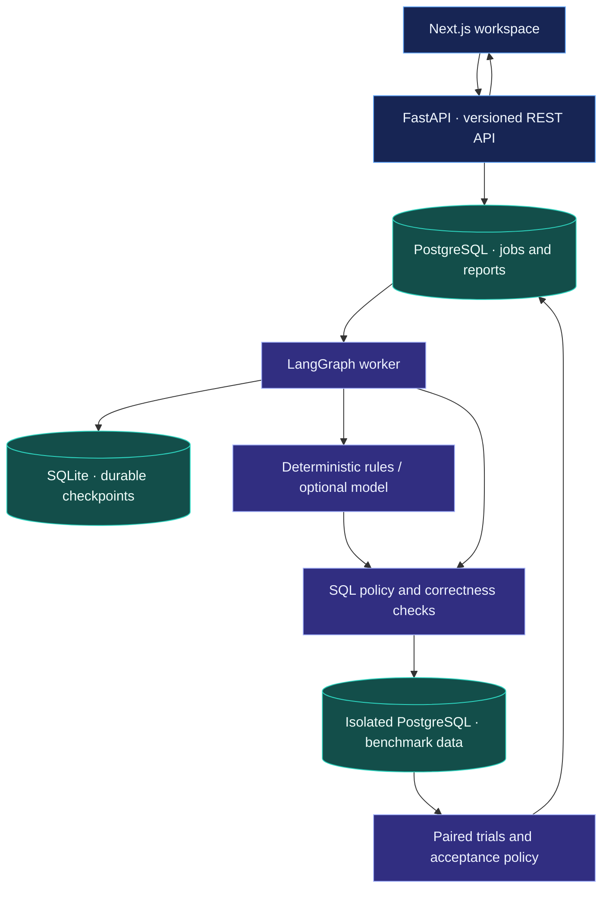
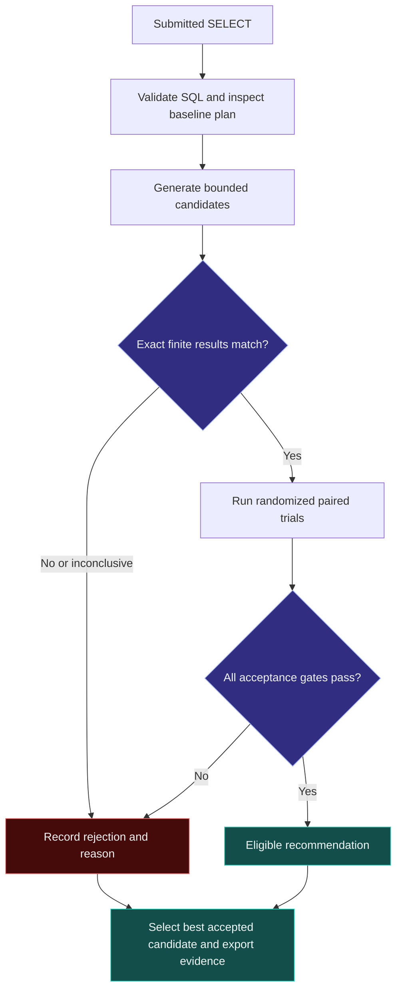

<div align="center">

# PostgreSQL Query Optimizer

**SQL rewrites and index experiments, validated against real PostgreSQL execution.**

[](pyproject.toml)
[](docker-compose.yml)
[](apps/web/package.json)
[](apps/web/tsconfig.json)
[](packages/optimizer/workflow.py)
[](LICENSE)

[Quick start](#quick-start) · [Architecture](#architecture) · [Benchmarks](#benchmarks) · [API](#api) · [Documentation](#documentation)

</div>

PostgreSQL Query Optimizer is a full-stack performance engineering workbench. It inspects execution plans, proposes SQL rewrites and indexes, checks result correctness, and runs repeated database experiments before recommending a change. A Next.js workspace exposes the SQL, plans, trial measurements, and decision behind each experiment.

PostgreSQL continues to choose execution plans. This application explores changes to the SQL and physical indexes available to that planner. Proposals come from deterministic rules or an optional OpenAI-compatible model; acceptance is controlled by code and measured results.

## Capabilities

| Capability | Implementation |
|---|---|
| **Plan diagnostics** | Parses `EXPLAIN (ANALYZE, BUFFERS, FORMAT JSON)` for scans, joins, row-estimate errors, sorts, and spills. |
| **SQL and index proposals** | SQLGlot expression simplification, predicate-based B-tree proposals, and optional typed model proposals. |
| **Correctness checks** | Exact result comparisons across commerce, edge-case, and empty datasets; preserves types, column metadata, duplicates, NULLs, and supported ordering contracts. |
| **Measured acceptance** | Randomized paired trials, bootstrap confidence intervals, variance limits, index storage limits, and protected workload checks. |
| **Durable execution** | PostgreSQL job queue, LangGraph checkpoints, interrupted-worker recovery, cooperative cancellation, and experimental index cleanup. |
| **Inspectable results** | Hierarchical plans, baseline/candidate charts, per-trial measurements, rejection reasons, and downloadable JSON reports. |
| **Observability** | Structured stage events, Prometheus metrics, and OpenTelemetry spans. |

[Desktop workspace](docs/assets/workspace-desktop.png) · [Mobile workspace](docs/assets/workspace-mobile.png)

<details>
<summary>View the application: SQL workspace, execution plans, and benchmark evidence</summary>


</details>

## Architecture

The application database stores jobs, events, and reports. A separate benchmark database contains the disposable commerce dataset. A single worker serializes experiments so concurrent index changes cannot contaminate measurements.



| Layer | Technologies |
|---|---|
| Frontend | Next.js App Router, React, strict TypeScript, Tailwind CSS, TanStack Query, Recharts |
| API and persistence | FastAPI, Pydantic v2, SQLAlchemy, Alembic, PostgreSQL |
| Optimization engine | Python 3.12, SQLGlot, Psycopg 3, LangGraph, SQLite checkpoints |
| Runtime and telemetry | Docker Compose, Prometheus, OpenTelemetry, optional Jaeger |
| Quality checks | Pytest, Ruff, strict Mypy, ESLint, TypeScript, Playwright, GitHub Actions |

### From proposal to recommendation



Each session evaluates up to eight candidates in one proposal round. The original SQL remains the recommendation when no candidate passes. Experimental indexes are removed after measurement; recommendations are not automatically applied to an external database.

## Benchmarks

The latest recorded [acceptance evaluation](experiments/reports/acceptance/evaluation.json) covers **12 workloads, 10 validated candidates, and zero accepted changes**. All deterministic sessions completed. All 12 model-assisted arms were unexecuted because no model credential was configured.

**Conditions:** PostgreSQL 16.16 on Linux; seed 42; 10,000 orders and 30,000 order items; warm cache; two warmup pairs and ten measured pairs per candidate. Index experiments additionally measured all 12 protected workloads with five pairs each. The Compose benchmark service is configured with two CPUs, 2 GiB memory, 256 MiB shared buffers, and 16 MiB `work_mem`.

| Workload | Original median, ms | Candidates | Best measured paired speedup | Accepted changes |
|---|---:|---:|---:|---:|
| `customer_lookup` | 0.2265 | 1 | 16.319× | 0 |
| `sales_window` | 0.6205 | 2 | 1.554× | 0 |
| `regional_revenue` | 16.0615 | 1 | 1.003× | 0 |
| `top_products` | 3.6040 | 0 | — | 0 |
| `purchase_history` | 2.9185 | 2 | 1.108× | 0 |
| `inventory` | 2.6350 | 0 | — | 0 |
| `suppliers` | 11.4160 | 0 | — | 0 |
| `shipment_delays` | 1.6695 | 0 | — | 0 |
| `correlated` | 293.8425 | 1 | 0.996× | 0 |
| `skew_join` | 3.7345 | 2 | 1.107× | 0 |
| `pagination` | 1.3735 | 1 | 19.841× | 0 |
| `analytics` | 1.1850 | 0 | — | 0 |

Original medians come from the evaluator's initial baseline. Speedups are medians of paired baseline/candidate ratios from separate candidate experiments; they cannot be reconstructed from the original-median column. A dash means no candidate was generated.

### Why a faster query can still be rejected

For `customer_lookup`, the proposed index on `orders(customer_id, ordered_at, id)` reduced the paired baseline median from **0.2325 ms to 0.0140 ms**. The median paired speedup was **16.319×**, with a **95% bootstrap interval of 15.286–18.917×**. The candidate passed finite correctness checks but failed the protected workload gate, so the original query was retained.

The pagination index similarly measured **19.841×** on its target query and failed the protected workload gate. Neither result is an accepted performance improvement. Across the ten candidates, seven failed the improvement/confidence gate and four failed the protected workload gate; one failed both.

### Default acceptance policy

| Gate | Requirement |
|---|---|
| SQL policy | One permitted SELECT; allowlisted syntax, relations, and functions |
| Correctness | Exact finite comparisons pass on all three datasets |
| Latency | At least 10% median paired latency reduction, expressed as speedup ≥ `1 / 0.9` |
| Confidence | Lower bound of the 95% paired bootstrap speedup interval exceeds `1.0` |
| Stability | Baseline and candidate coefficients of variation ≤ `0.35` |
| Index storage | Experimental index size ≤ 64 MiB |
| Workload protection | For index changes, every protected workload has a lower speedup bound ≥ `0.9` |

Confidence intervals use 2,000 bootstrap resamples. p95 is omitted below 40 observations. These are small-sample, local warm-cache measurements; protected-gate failures can reflect uncertainty as well as slower execution. Index build time and correctness reads are excluded from query execution latency. Write throughput, model benefit, and medium/large dataset performance have not been measured.

[Raw trials, plans, and rejection reasons](experiments/reports/acceptance/evaluation.json) · [Aggregate metrics](experiments/reports/acceptance/summary.json) · [Methodology](docs/benchmarking.md)

## Quick start

**Requirement:** Docker with Compose. Node and Python installations are only needed for host-side development.

```sh
cp .env.example .env
docker compose up --build -d --wait
```

Compose creates both PostgreSQL databases, applies migrations, seeds the small dataset, and starts the API, worker, and frontend. Deterministic mode requires no model credentials.

| Service | Address |
|---|---|
| SQL workspace | [localhost:3000](http://localhost:3000) |
| Interactive API documentation | [localhost:8000/docs](http://localhost:8000/docs) |
| Readiness | [localhost:8000/api/v1/readiness](http://localhost:8000/api/v1/readiness) |
| Application PostgreSQL | `localhost:5433` |
| Benchmark PostgreSQL | `localhost:5434` |

Select a workload, choose the deterministic provider, and run an optimization. The completed session displays the recommendation, correctness results, plans, and benchmark evidence.

### Optional model proposals

Set `PGO_OPENAI_API_KEY` in `.env`, optionally set `PGO_MODEL` (default: `gpt-4.1-mini`), then recreate the backend services:

```sh
docker compose up -d --force-recreate api worker
```

Select `openai` in the workspace. Model output is parsed into typed proposals and passes through the same deterministic checks. Invalid or unavailable model output can fall back to deterministic candidates; evaluation reports distinguish fallback-only runs from model contributions. Model calls may incur provider charges.

### Reproduce the evaluation

With the worker running:

```sh
docker compose exec -e PGO_OPENAI_API_KEY= api \
  pg-optimizer evaluate --output /app/experiments/reports/latest
docker compose cp api:/app/experiments/reports/latest experiments/reports/latest
```

This command runs the deterministic arm without model calls and produces `evaluation.json`, `summary.json`, and `evaluation.md`. Add `--workloads customer_lookup pagination` to evaluate selected workloads.

The generator supports 10,000, 100,000, or 1,000,000 orders, each with three order items. To switch to the medium dataset:

```sh
docker compose stop worker
docker compose run --rm seed pg-optimizer seed --size medium --seed 42
docker compose start worker
```

Generation replaces benchmark data; existing reports retain the environment and dataset recorded at execution time.

## API

Submit a query:

```sh
curl -X POST http://localhost:8000/api/v1/optimizations \
  -H 'Content-Type: application/json' \
  -d '{"sql":"SELECT id FROM commerce.orders WHERE customer_id = 731","provider":"deterministic"}'
```

The API returns HTTP `202` with a session identifier. Substitute that identifier for `{id}` below.

| Method | Endpoint | Purpose |
|---|---|---|
| `GET` | `/api/v1/workloads` | List predefined workloads |
| `POST` | `/api/v1/optimizations` | Queue an experiment |
| `GET` | `/api/v1/optimizations/{id}` | Retrieve status and session details |
| `GET` | `/api/v1/optimizations/{id}/report` | Retrieve the JSON experiment report |
| `POST` | `/api/v1/optimizations/{id}/cancel` | Request cooperative cancellation |
| `GET` | `/metrics` | Export API Prometheus metrics |

Reports include original and recommended SQL, index proposals, diagnostics, environment metadata, candidate validation, paired measurements, acceptance policy, and model usage.

## Development and tests

Host development uses Python 3.12 in the dedicated Conda environment and Node 22. Python and npm dependencies are pinned in lockfiles.

```sh
conda env create -f environment.yml
conda activate postgres-query-optimizer
cd apps/web
npm ci
npx playwright install chromium
cd ../..
python scripts/verify_local.py
```

`verify_local.py` runs dependency consistency, Python tests, Ruff lint/format checks, strict Mypy, frontend lint/types/unit tests, the production build, and Compose configuration validation.

With Docker running and frontend browser dependencies installed, execute the stack acceptance suite:

```sh
sh scripts/verify_stack.sh
```

The stack suite builds the images, runs PostgreSQL integration and browser tests, verifies worker process recovery and cancellation, and evaluates the 12 deterministic workloads. The queue must be drained before the process recovery tests. Results are saved under `experiments/reports/acceptance`.

GitHub Actions defines separate [quality/integration](.github/workflows/ci.yml) and [manually dispatched evaluation](.github/workflows/evaluate.yml) workflows.

## Scope

The implemented workflow targets a controlled local commerce database. SQL execution uses a read-only role, repeatable-read snapshots, query timeouts, estimated-cost limits, and bounded result collection. A separate experiment role creates structured experimental indexes under an advisory lock. Compose binds exposed services to loopback.

Finite comparisons validate sampled database states rather than proving arbitrary SQL equivalence. Execution uses one worker and one proposal round. Cancellation takes effect between stages or trials, after an active statement finishes or times out. Production deployment requires deployment-specific authentication, TLS, secret management, and isolation; the included passwords are local development defaults.

## Repository map

| Path | Responsibility |
|---|---|
| [`packages/optimizer`](packages/optimizer) | SQL policy, plan analysis, providers, correctness, statistics, workflow, API, and worker |
| [`apps/web`](apps/web) | SQL workspace, plan viewer, benchmark charts, API proxy, and browser tests |
| [`datasets`](datasets) | Commerce schema and edge-case fixtures |
| [`infrastructure`](infrastructure) | Database roles, migrations, containers, and metrics configuration |
| [`tests`](tests) | Unit tests, provider contracts, PostgreSQL integration, and worker recovery |
| [`experiments/reports`](experiments/reports) | Recorded evaluations, aggregate metrics, and verification evidence |
| [`scripts`](scripts) | Local checks, stack acceptance, dependency locks, and publication |

## Documentation

- [Architecture and recovery](docs/architecture.md)
- [Agent workflow](docs/agent-workflow.md)
- [Benchmark methodology](docs/benchmarking.md)
- [Evaluation metrics and provider accounting](docs/evaluation.md)
- [Security boundaries](docs/security.md)
- [Deployment and observability](docs/deployment.md)
- [Architecture decisions](docs/decisions)

Licensed under the [MIT License](LICENSE).
