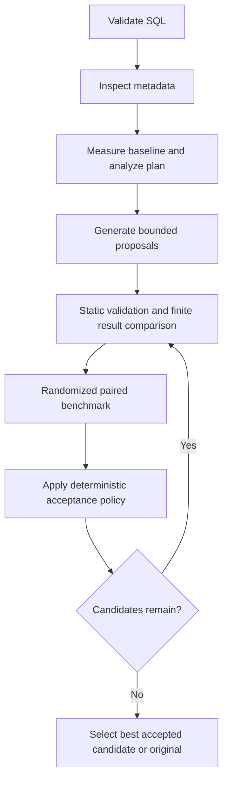

# Optimization workflow

`State` is a TypedDict. A session UUID is the LangGraph thread ID. The graph records
its start time, request, fingerprint, metadata, plan, diagnostics, proposals,
results and final report. Default bounds are eight candidates, 30 seconds per SQL
statement, ten measured pairs and 300 seconds per session. There is one proposal
round. The configured round ceiling is recorded, but adaptive follow-up rounds
are not implemented.

The OpenAI provider submits typed candidate data through a JSON response contract.
Pydantic rejects unknown fields and malformed schemas. The engine deduplicates
normalized SQL plus structured index proposals. Model suggestions cannot execute
DDL or select acceptance outcomes.

The provider estimates a conservative input byte bound and reserves output tokens.
Over-budget context avoids the call. One provider request is attempted. Unknown
billing or schema failures are not retried automatically. Deterministic proposals
remain available on failure. Token usage is recorded when supplied by the provider.
Unknown usage and cost remain null, never zero.

The deterministic provider applies SQLGlot predicate simplification and proposes
B-tree indexes on literal filter columns. Compatible order columns can extend the
index. Existing single-column index definitions suppress obvious duplicates.
Semantic safety still requires finite result comparisons. Statistics diagnostics
are recommendations, not automatic ANALYZE operations.

Partial and covering indexes have typed proposal support and validation, but the
deterministic generator does not currently propose those variants. HypoPG,
join reassociation and correlated-subquery transformations are not implemented.
