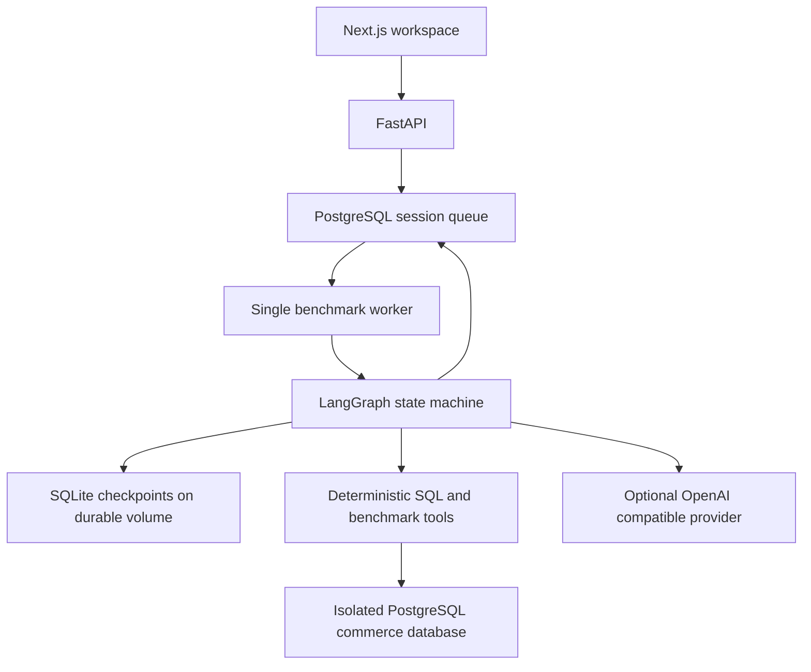

# Architecture

The API enqueues PostgreSQL application records. A separate worker claims records
with row locks. A worker-wide PostgreSQL advisory lock permits one active worker.
A benchmark-database advisory lock excludes dataset regeneration and concurrent
index experiments. PostgreSQL's own planner still selects execution plans.

## Boundaries

| Component | Responsibility |
|---|---|
| `api.py` | Request contracts, quotas, idempotency, cancellation and reports |
| `workflow.py` | Typed graph state, finite routing and acceptance orchestration |
| `providers.py` | Deterministic or model candidate proposals |
| `safety.py` | Positive SQL syntax, relation and function policy |
| `database.py` | Read-only pools, plans, metadata and structured index DDL |
| `equivalence.py` | Exact finite comparisons on one repeatable-read snapshot |
| `benchmark.py` | Warmups, randomized pairs, index cleanup and regression gate |
| `statistics.py` | Paired bootstrap, variance and acceptance |
| `persistence.py` | Durable jobs, reports, errors and stage events |

The local worker is intentionally serialized. SQLite checkpoints must reside on a
single durable volume. Sharing that file among workers or hosts is unsupported.
Application data remains in PostgreSQL. No Redis requirement exists for this queue.

Each graph stage emits an event and an OpenTelemetry span. Checkpoints contain
JSON-compatible state. SQL, model outputs, plans and measurements are persisted
for completed sessions. Failed and cancelled sessions retain events and graph
checkpoints. Their API reports currently contain an error rather than a merged
partial report.

## Recovery

The worker obtains the application advisory lock before requeuing interrupted
running sessions. Existing LangGraph checkpoints resume with the same thread ID.
A candidate stage interrupted before checkpoint commit may execute again. Index
names are stable per session and candidate position. The next experiment removes
orphaned experimental indexes under the exclusive experiment lock.

Recovery is limited to three claims. Wall-clock budgets include downtime.
Cancellation is cooperative between stages and trials. A running PostgreSQL
statement finishes or reaches the statement timeout. Immediate backend cancellation
is not implemented. There is no automatic promotion of SQL or indexes.
